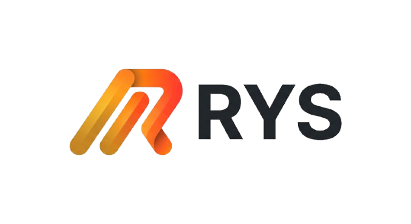

<p align="center">
  
</p>

# The RYS Programming Language

**RYS** (Rapid Yet Safe) is a programming language with Python-style syntax, implemented in Rust. This repository contains the RYS lexer, parser, bytecode compiler, virtual machine, verifier, and bytecode cache.

[Quick start](#quick-start) · [Building from source](#building-from-source) · [Usage](#usage) · [Contributing](#contributing)

## Quick start

Create a file named `hello.rys`:

```python
print("Hello, world!")
```

Build RYS as described below, then run:

```sh
./target/release/rys hello.rys
```

Running RYS without a file starts the interactive REPL. Type `exit` to quit.

## Building from source

You'll need the Rust toolchain and Cargo. Clone the repository and build a release binary:

```sh
git clone https://github.com/Amogrotex/rys-language.git
cd rys-language
cargo build --release
```

The binary is created at `target/release/rys` (or `target/release/rys.exe` on Windows). The project declares no external Cargo dependencies. The repository also includes a prebuilt Linux x86-64 binary. Build from source for other platforms.

## Usage

```sh
# Start the REPL
./target/release/rys

# Run a program
./target/release/rys program.rys

# Display compiled bytecode
./target/release/rys --dump program.rys

# Display help or the version
./target/release/rys --help
./target/release/rys --version
```

RYS can cache compiled bytecode in `.rysc` files. Set `RYS_NO_CACHE=1` to disable the cache:

```sh
RYS_NO_CACHE=1 ./target/release/rys program.rys
```

## Language and built-ins

RYS supports functions, conditionals, loops, arrays, ranges and Python-style indentation. Trailing commas are allowed in function parameters, function calls and array literals.

Alongside built-ins such as `print`, `len`, `push`, `pop`, `range` and `type`, RYS provides:

| Function | Description |
| --- | --- |
| `upper(text)`, `lower(text)` | Return a string with Unicode case conversion. |
| `trim(text)` | Remove surrounding whitespace. |
| `split(text, separator)` | Split a string into an array; the separator must not be empty. |
| `join(array, separator)` | Join an array of strings. |
| `contains(text, substring)` | Check whether a string contains a substring. |
| `reverse(value)` | Return a reversed string or a new reversed array without modifying the original. String reversal works on Unicode scalar values. |

See [`examples/features.rys`](examples/features.rys) for examples. Run the test suite with `cargo test`.

## File extensions

RYS programs use the `.rys` extension; see [`examples/hello.rys`](examples/hello.rys). The files under `src/` use `.rs` because the RYS compiler and virtual machine are themselves written in Rust. Cargo compiles those Rust files to produce the `rys` executable, which then runs `.rys` programs. Cached bytecode uses `.rysc`.

## Repository layout

- `src/main.rs` — lexer, parser, built-ins, and command-line interface
- `src/bytecode.rs` — bytecode compiler and virtual machine
- `src/verify.rs` — bytecode verifier
- `src/cache.rs` — compiled-bytecode cache

## Performance

RYS uses a bytecode VM and a compiled-bytecode cache. See the [performance guide](docs/performance.md) for benchmarks, profiling instructions and the proposed JIT and native compilation roadmap. Neither a JIT nor an ahead-of-time native compiler is implemented yet.

## Contributing

Issues and pull requests are welcome. Please describe the problem or proposed change and include a minimal example when reporting a bug. Before submitting code, build the project and run `cargo test`.

## License

A license has not yet been specified for this repository. Please contact the repository owner for permission before reusing or redistributing the code.
